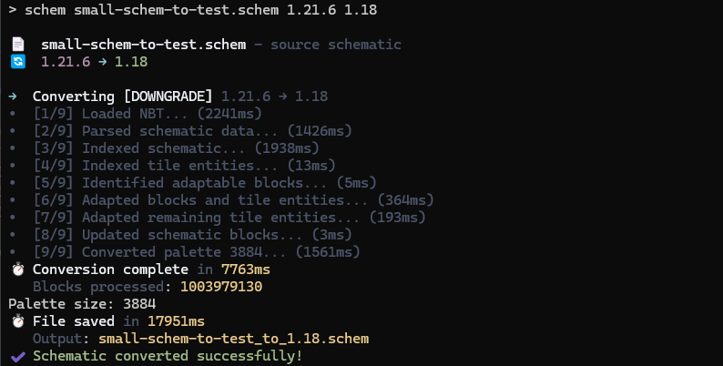
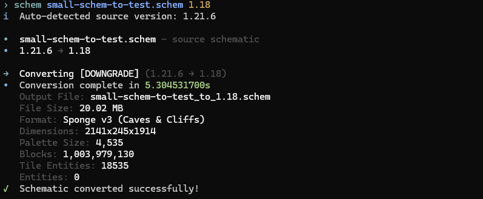
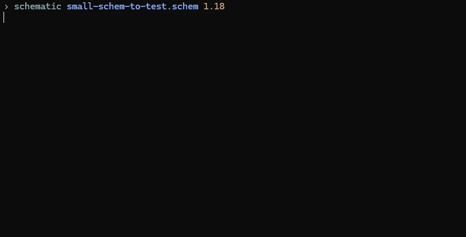

<div align="center">
  
  <h1 align="center" style="margin-top: 10px;">Totem</h1>
</div>

<p align="center">
  
  
  
</p>

Totem is an off-heap Named Binary Tag (NBT) library for Kotlin/JVM built on Java's Foreign Function & Memory API (JEP 454) and a native Rust library (`totem-sys`). Requires JDK 24+.

## Key Features

* **Off-Heap NBT**: Read and traverse large NBT trees directly from native memory without allocating on the JVM heap.
* **Header Inspection (`Totem.inspect`)**: Read root metadata (`DataVersion`, dimensions, author) from compressed schematics in microseconds without decompressing block arrays.
* **Native Block Codecs**: Rust VarInt (`toVarIntShortArray`) and 64-bit bit-packing (`BlockDataCodec`) codecs with AVX2 palette lookup translation (`ShortView.translate`).
* **Anvil Region Files**: Memory-mapped `.mca` chunk reading and writing (`AnvilRegionFile`).
* **Kotlin Builders**: Tree-based (`Tags.compound`) and streaming (`Totem.write`) builders.

## Architecture

### Off-Heap Layouts & Panama FFM
Instead of deserializing binary payloads into heap objects, Totem maps NBT structures over raw `MemorySegment` slices using the [Foreign Function & Memory API (JEP 454)](https://openjdk.org/jeps/454).

> [!NOTE]
> **Flyweight Value Classes**: Off-heap tags are Kotlin [inline value classes](https://kotlinlang.org/docs/inline-classes.html) (`@JvmInline value class`) wrapping a `MemorySegment`. At runtime, the wrapper is erased to a 64-bit segment reference.
> 
> **Zero-Copy Slicing**: Nested tags are read via `segment.asSlice(...)` without copying bytes to the JVM heap.

### Native Codecs & Parallel I/O
* **VarInt & Palette Translation**: `totem-sys` decodes and encodes VarInt streams and translates 16-bit block palettes via lookup tables using AVX2 on `x86_64` and 64-bit [SWAR](https://en.wikipedia.org/wiki/SWAR) fallbacks.
* **Bit-Packing (`BlockDataCodec`)**: Packs and unpacks both padded (1.16+ Anvil) and spanning (`precise = true`, 1.13–1.15 Anvil & Litematica) 64-bit `LongArray` block states directly off-heap, splitting volumes `>= 262,144` blocks across worker threads.
* **Composite Serialization & Multi-Member GZIP**: During serialization, native array payloads `>= 1 MB` are passed by slice reference rather than copied, and payloads `>= 256 KB` are compressed and decompressed in parallel across CPU cores.

> [!TIP]
> **16-Bit Block States**: Since block palettes fit within 65,536 states, Totem decodes block data into unsigned 16-bit `Short` views rather than 32-bit `Int` arrays, cutting memory usage and bandwidth in half.

## Performance Benchmark

End-to-end NBT pipeline (loading a compressed schematic of 44 million blocks (`18578.schem`), replacing block IDs across the volume, and saving back to a GZIP file):

| Library / Pipeline | Avg Time (`ms/op`) | Error (99.9% CI) | Min – Max (`ms`) | StdDev (`σ`) | Performance vs Querz |
| :--- | ---: | ---: | ---: | ---: | :--- |
| **Querz NBT** (Standard Java NBT) | 929.20 ms | ± 130.61 ms | 899.80 – 970.90 ms | 33.92 ms | Baseline (`1.00x`) |
| **Totem 1.0.2** | 216.19 ms | ± 46.86 ms | 201.51 – 231.03 ms | 12.17 ms | 4.30x Faster |
| **Totem 2.0.2** | **76.93 ms** | **± 11.87 ms** | **72.17 – 80.50 ms** | **3.08 ms** | **12.08x Faster** |

*Measured with JMH 1.37 (`5 × 2s` measurement iterations, `3 × 2s` warmup, `-Xms6g -Xmx8g -XX:+AlwaysPreTouch`) on an **AMD Ryzen 7 6800HS** (8 cores / 16 threads) running JDK 24.0.1 (HotSpot 64-Bit Server VM).*

### 1 Billion Blocks Schematic Conversion

CLI execution times when downgrading a **1,003,979,130-block** schematic (`2141x245x1914`, `18,535` Tile Entities) from 1.21.6 to 1.18:

#### Without Totem — Standard Heap NBT (`25.71s`: `7.76s` load/convert + `17.95s` save)


#### With Totem 1.0.2 (`5.30s` — `4.85x` faster)


#### With Totem 2.0.0 (`1.69s` — `15.21x` faster)


## Dependency

Add the dependency to your `build.gradle.kts` using GitHub Packages:

```kotlin
repositories {
    maven {
        url = uri("https://maven.pkg.github.com/punkrecordz/totem")
        credentials {
            username = project.findProperty("gpr.user") as String? ?: System.getenv("GITHUB_USER")
            password = project.findProperty("gpr.token") as String? ?: System.getenv("GITHUB_TOKEN")
        }
    }
}

dependencies {
    implementation("org.punkrecordz:totem:2.0.2")
}
```

## Usage Examples

### Loading & Reading a Compressed NBT File (e.g., level.dat)
```kotlin
import java.lang.foreign.Arena
import org.punkrecordz.totem.Totem
import java.nio.file.Path

Arena.ofConfined().use { arena ->
    val (name, rootTag) = Totem.load(Path.of("level.dat"), arena)
    val data = rootTag.getCompound("Data")
    if (data != null) {
        val version = data.getInt("DataVersion")
        println("Loaded '$name' (DataVersion: $version)")
    }
}
```

### Inspecting Schematic Metadata Without Full Decompression
```kotlin
import java.lang.foreign.Arena
import org.punkrecordz.totem.Totem
import java.nio.file.Path

Arena.ofConfined().use { arena ->
    val (_, rootTag) = Totem.inspect(Path.of("massive.schem"), arena)
    val dataVersion = rootTag.getInt("DataVersion")
    val width = rootTag.getShort("Width")
    println("Schematic DataVersion=$dataVersion, Width=$width")
}
```

### Reading a Chunk from an Anvil Region File (.mca)
```kotlin
import java.io.File
import java.lang.foreign.Arena
import org.punkrecordz.totem.anvil.AnvilRegionFile

val regionFile = File("r.0.0.mca")
AnvilRegionFile(regionFile, writeMode = false).use { region ->
    Arena.ofConfined().use { arena ->
        // Read chunk at local coordinates (0, 0)
        val chunkData = region.readChunk(0, 0, arena)
        if (chunkData != null) {
            val (chunkName, chunkTag) = chunkData
            // Process chunkTag...
        }
    }
}
```

### Writing Tags via DSL
```kotlin
import org.punkrecordz.totem.Totem
import java.nio.file.Path

Totem.write(Path.of("output.dat")) {
    int("DataVersion", 3463)
    compound("Player") {
        string("Name", "Steve")
        double("Health", 20.0)
    }
}
```

### Bit-Packing Chunk Sections & Litematica Regions
```kotlin
import java.lang.foreign.Arena
import org.punkrecordz.totem.codec.BlockDataCodec
import org.punkrecordz.totem.view.toBitPackedLongArray
import org.punkrecordz.totem.view.toBitPackedShortArray

// Zero-copy off-heap unpacking from a LongArrayTag (e.g. Anvil 16x16x16 section)
val blockStates: ShortArray = BlockDataCodec.unpackShorts(
    packed = blockStatesTag,
    bitsPerEntry = 5,
    count = 4096,
    precise = false, // false = 1.16+ padded, true = 1.13-1.15 & Litematica spanning
)

// Or full off-heap ShortView pipeline for large Litematica regions
Arena.ofConfined().use { arena ->
    val unpackedView = blockStatesTag.toBitPackedShortArray(volume, bitsPerEntry, arena, precise = true)
    unpackedView.translate(paletteLookupTable)
    val repackedTag = unpackedView.toBitPackedLongArray(newBitsPerEntry, arena, precise = true)
}
```

## Building

To compile the native Rust library and package the JAR:

```bash
./gradlew jar
```
